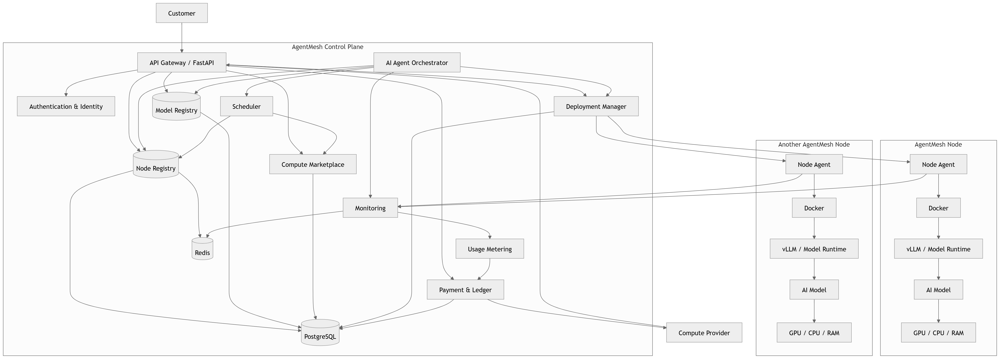

# AgentMesh

AgentMesh is a decentralized platform for deploying and running AI models securely and efficiently.

## Architecture



## Prerequisites

- Python 3.12+
- Node.js 20+
- Docker & Docker Compose
- PostgreSQL 16
- Redis 7

## Quick Start (Development)

1. Clone the repository
2. Copy environment variables:
   ```bash
   cp .env.example .env
   ```
3. Start infrastructure services:
   ```bash
   docker-compose up -d postgres redis
   ```
4. Setup Backend (Control Plane):
   ```bash
   cd server
   pip install -r requirements.txt
   alembic upgrade head
   uvicorn app.main:app --reload
   ```
5. Setup Frontend (Dashboard):
   ```bash
   cd client
   npm install
   npm run dev
   ```
6. Setup Node Agent (in a new terminal):
   ```bash
   cd server/node_agent
   # Register and start node agent
   uvicorn app.main:app --port 8001 --reload
   ```


## Makefile Commands

A comprehensive `Makefile` is provided. Run `make help` or refer to the Makefile itself for all available commands.

## Docker Deployment

To deploy using Docker:
```bash
make docker-build
docker-compose up -d
```

## Contributing

See `CONTRIBUTING.md` for guidelines.

## License

MIT License.


# TODO

- Implement the node installation